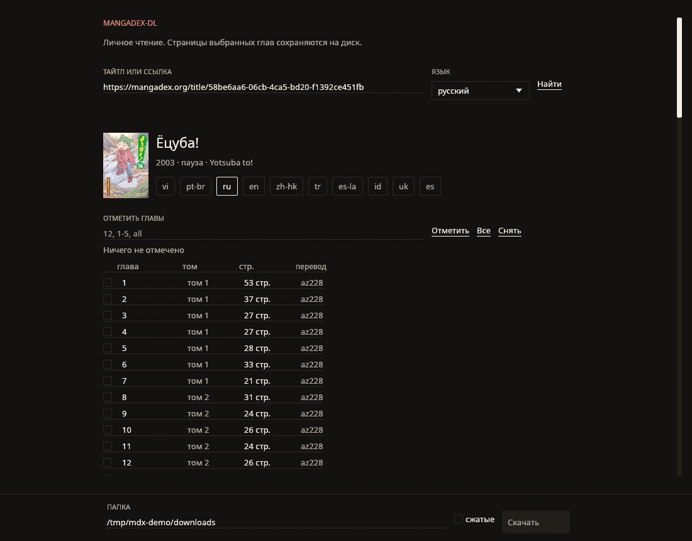
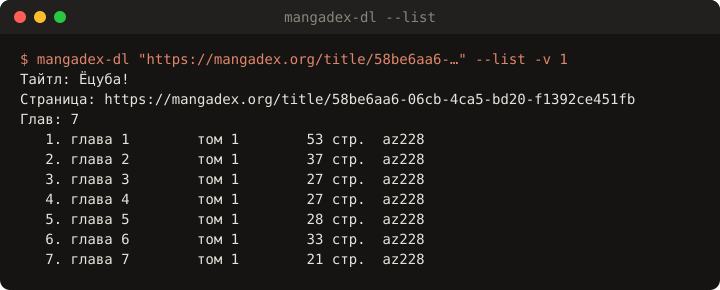
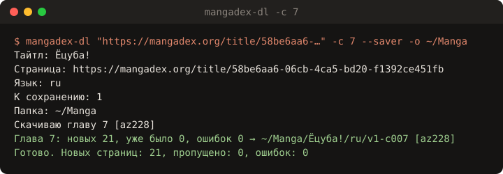

<div align="center">

# 📚 mangadex-dl

**Личный некоммерческий загрузчик страниц глав с [MangaDex](https://mangadex.org). Windows и Linux.**

[](https://github.com/AbobaAI/mangadex-dl/releases/latest)
[](https://github.com/AbobaAI/mangadex-dl/actions/workflows/test.yml)
[](LICENSE)




</div>

Ищете тайтл, отмечаете главы, жмёте «Скачать» — страницы ложатся в папку на диске. Работает через официальный API MangaDex, одним файлом без установки: есть обычное окно и режим командной строки.

## ✨ Возможности

- 🪟 **Нативное окно** — поиск, обложки, выбор языка перевода, отметка глав и прогресс загрузки. Без браузера и локального сервера.
- ⌨️ **Командная строка** — те же действия флагами или вопросами в терминале (`--cli`).
- 🔗 **Принимает что угодно** — название, ссылку на тайтл или ссылку на конкретную главу.
- 🎯 **Гибкий выбор глав** — `12`, `1-5`, `1,3,8`, `all`, `#2`, `oneshot`, фильтр по тому.
- 🌍 **Любой язык перевода** — по умолчанию русский; если глав нет, программа покажет доступные языки.
- 🔁 **Докачка** — повторный запуск пропускает уже скачанные страницы, `--force` качает заново.
- 🗜️ **Сжатые страницы** — `--saver` для экономии трафика и места.
- 🤝 **Бережно к сайту** — паузы между запросами и отчёты сети MangaDex@Home о каждой странице.

## 📸 Как это выглядит

<table>
<tr>
<td width="50%"></td>
<td width="50%"></td>
</tr>
<tr>
<td align="center"><sub>Список глав тома: <code>--list -v 1</code></sub></td>
<td align="center"><sub>Скачивание одной главы: <code>-c 7</code></sub></td>
</tr>
</table>

## 📦 Установка

### Готовые сборки

Скачайте файл для своей системы со страницы [Releases](https://github.com/AbobaAI/mangadex-dl/releases/latest):

| Система | Файл |
| --- | --- |
| Windows 10/11 x64 | `mangadex-dl-windows-x64.exe` |
| Linux x64 | `mangadex-dl-linux-x64` или `mangadex-dl-linux-x64.tar.gz` (с иконкой и ярлыком) |

**Windows:** просто запустите `.exe`. SmartScreen может предупредить о неизвестном издателе — «Подробнее» → «Выполнить в любом случае».

**Linux:**

```bash
chmod +x mangadex-dl-linux-x64
./mangadex-dl-linux-x64
```

Чтобы программа появилась в меню приложений с иконкой, возьмите архив:

```bash
tar -xzf mangadex-dl-linux-x64.tar.gz && cd mangadex-dl-linux-x64
install -Dm755 mangadex-dl ~/.local/bin/mangadex-dl
install -Dm644 mangadex-dl.png ~/.local/share/icons/hicolor/512x512/apps/mangadex-dl.png
install -Dm644 mangadex-dl.desktop ~/.local/share/applications/mangadex-dl.desktop
```

### Сборка из исходников

Нужен Rust 1.95 или новее.

```bash
git clone https://github.com/AbobaAI/mangadex-dl.git
cd mangadex-dl
cargo build --release
```

Готовый файл: `target/release/mangadex-dl` (Linux) или `target\release\mangadex-dl.exe` (Windows).

На Linux окну нужны библиотеки Wayland, X11 и Vulkan — на рабочем столе они обычно уже есть. Если линковка просит пакеты (Debian/Ubuntu):

```bash
sudo apt-get install pkg-config libwayland-dev libxkbcommon-dev libvulkan-dev \
  libxcb-render0-dev libxcb-shape0-dev libxcb-xfixes0-dev
```

## 🚀 Использование

Без аргументов открывается окно:

```bash
mangadex-dl
```

Тот же сценарий вопросами в терминале:

```bash
mangadex-dl --cli
```

Примеры командной строки:

```bash
# Одна глава на русском
mangadex-dl "Ёцуба" -c 1 -l ru

# Главы 1–5 в английском переводе, в свою папку
mangadex-dl "https://mangadex.org/title/UUID" -c 1-5 -l en -o ~/Manga

# Только посмотреть список глав
mangadex-dl "https://mangadex.org/title/UUID" --list -l ru

# Конкретная глава по ссылке
mangadex-dl "https://mangadex.org/chapter/UUID"

# Сжатые страницы
mangadex-dl "Название" -c 12 --saver
```

### Флаги

| Флаг | Что делает | По умолчанию |
| --- | --- | --- |
| `TARGET` | название, ссылка на тайтл или главу | — |
| `-c`, `--chapter` | какие главы скачать | спросит |
| `-l`, `--lang` | язык перевода | `ru` |
| `-v`, `--volume` | только этот том | все |
| `-o`, `--out` | папка для страниц | `downloads` |
| `--saver` | сжатые страницы | выкл. |
| `--list` | показать главы и выйти | — |
| `--force` | скачать страницы заново | выкл. |
| `--pick N` | номер тайтла в результатах поиска | — |
| `--cli` | вопросы в терминале вместо окна | — |

### Как указать главы

| Запись | Что скачается |
| --- | --- |
| `12` | глава 12, самый свежий перевод |
| `1-5` | главы с 1 по 5, включая дробные номера внутри диапазона |
| `1,3,8` | эти главы |
| `all` или `все` | все главы выбранного языка |
| `#2` | вторая строка списка, даже если у номера главы несколько переводов |
| `oneshot` | глава без номера |

Если у номера главы несколько групп, скачивается самый свежий перевод, остальные видны в списке как `#номер`.

### Куда складываются страницы

```text
downloads/
└── Ёцуба!/
    └── ru/
        └── v1-c007 [az228]/
            ├── 001.jpg
            ├── 002.jpg
            └── …
```

Если у главы нет группы переводчиков, в имени папки будет имя загрузившего главу.

## ❓ FAQ и ограничения

<details>
<summary><b>Почему загрузка не мгновенная?</b></summary>

Программа специально делает паузы между запросами, чтобы не нагружать MangaDex и не попасть под ограничения API. Глава на ~20 страниц качается несколько минут.
</details>

<details>
<summary><b>Глава есть на сайте, но не скачивается</b></summary>

Часть глав на MangaDex — внешние ссылки на сайты издателей (в списке помечены «внешняя ссылка»). Их страниц на MangaDex нет, и скачать их нельзя.
</details>

<details>
<summary><b>Нет глав на нужном языке</b></summary>

Программа покажет, на каких языках есть переводы. Укажите другой через `-l`, например `-l en`.
</details>

<details>
<summary><b>Можно ли скачивать в CBZ/PDF?</b></summary>

Пока нет: страницы сохраняются как есть, отдельными изображениями.
</details>

## ⚖️ Правовая оговорка

Инструмент предназначен **только для личного некоммерческого чтения** глав, которые вы и так можете открыть на MangaDex. Авторские права на мангу принадлежат правообладателям и переводчикам. Не распространяйте скачанное и соблюдайте [правила MangaDex](https://mangadex.org/about) и [условия API](https://api.mangadex.org/docs/). Проект не связан с MangaDex.

Если нравится тайтл — поддержите авторов, купив официальное издание.

## 🧪 Разработка

```bash
cargo test
```

Тег `v*` запускает сборку релиза в GitHub Actions для Windows и Linux.

## 📄 Лицензия

[MIT](LICENSE) © 2026 AbobaAI
